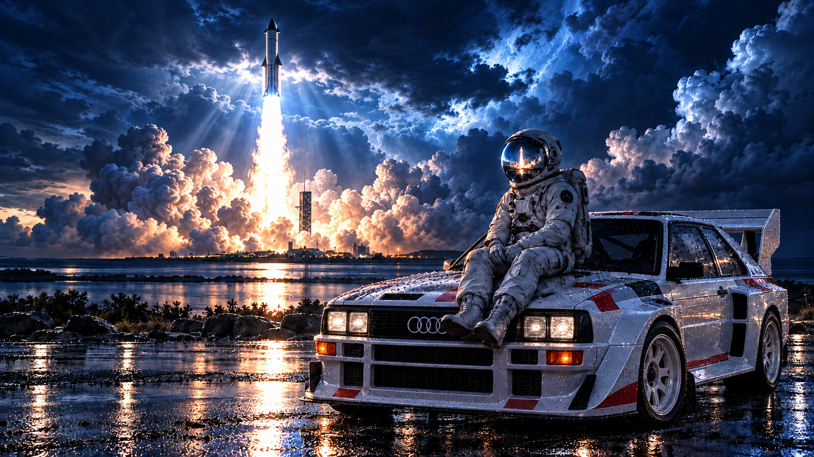

# Starship Quattro RS for Omarchy

A midnight-blue night-launch theme pairing a Starship lift-off and an astronaut with a classic Audi rally quattro: deep navy surfaces, ice-cyan accents, silver text, restrained launch-amber highlights, and blue folder icons.



## Install

```sh
omarchy theme install https://github.com/MrJazzMan/omarchy-starship-quattro-rs-theme
```

Requires a recent Omarchy that generates application themes from `colors.toml`.

## Backgrounds

One wallpaper is included.

### Starship Quattro


The wallpaper is an AI-generated concept image upscaled to 6K (6144 × 3456) with Lanczos resampling; it is not a real launch photograph or a native 6K render. A [reconstructed generation prompt](PROMPTS.md) is included.

## Palette

| Role | Color |
| --- | --- |
| Background | `#091321` |
| Foreground | `#DCE8F5` |
| Ice-cyan accent | `#7CCBFF` |
| Selection | `#233E5B` |

Omarchy generates application themes from `colors.toml`.

Independent community theme; no affiliation with or endorsement by Audi or SpaceX. Brand marks remain the property of their respective owners.

## License

MIT
